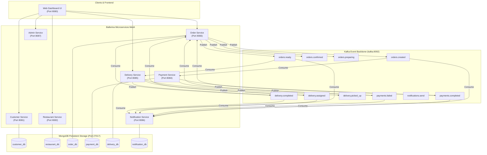
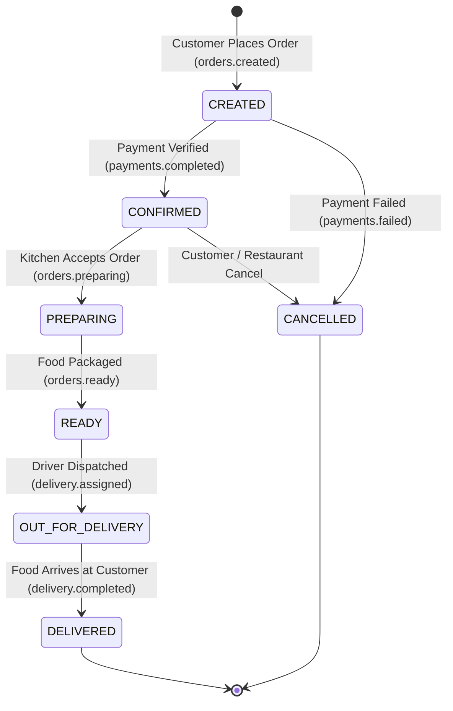

# FoodPulse — Distributed Food Delivery Platform
### Distributed Systems and Applications (DSA612S) — Assignment 2
**Ministry of Industrialisation and Trade — SME Food Delivery Initiative**

---

## 1. Executive Summary & Overview

Modern food delivery demands resilient, scalable, asynchronous coordination across independent distributed actors: **Customers**, **Restaurants**, and **Delivery Drivers**. Commissioned for the **Ministry of Industrialisation and Trade**, this platform is designed to empower local Small and Medium Enterprises (SMEs) with a fault-tolerant microservices ecosystem.

### Core Technologies
- **Microservices Architecture**: 7 Autonomous Microservices built in **Ballerina Swan Lake (2201.13.5)**.
- **Event-Driven Messaging**: **Apache Kafka** with multi-partitioned topics for decoupled asynchronous coordination.
- **Data Persistence**: **MongoDB** with dedicated per-service databases ensuring loose coupling and domain isolation.
- **Container Orchestration**: **Docker & Docker Compose** for reproducible local deployment and environment stability.
- **Bonus Extensions**:
  - 🗺️ **Real-Time Driver Location Simulation**: Continuous GPS coordinate updates along route waypoints on an interactive map.
  - 🧭 **Route Optimization & ETA**: Haversine distance algorithm calculating optimized paths and travel times.
  - ⚡ **Dynamic Surge Pricing**: Real-time demand-to-fleet ratio pricing multiplier.
  - 🖥️ **Web Dashboard UI**: Deployable interactive dashboard for customers, kitchen KDS, driver tracking, and admin analytics.
  - 📊 **Observability**: Prometheus & Grafana metrics pipeline.

---

## 2. High-Level Architecture Diagram



---

## 3. Order Lifecycle State Machine

The central Order Service enforces a strict state machine ensuring consistency:



---

## 4. Kafka Topics Specification

All Kafka topics are provisioned with **3 partitions** and **replication factor 1** (configured in `docker-compose.yml`):

| Kafka Topic | Producer | Consumers | Event Description |
|---|---|---|---|
| `orders.created` | Order Service | Payment Service, Notification Service | Emitted when a new customer order is placed. Triggers automated payment and customer confirmation alert. |
| `payments.completed` | Payment Service | Order Service, Notification Service | Emitted upon successful payment gateway simulation (~90% success rate). Moves order to `CONFIRMED`. |
| `payments.failed` | Payment Service | Order Service, Notification Service | Emitted if payment fails. Moves order to `CANCELLED` and notifies customer to retry. |
| `orders.confirmed` | Order Service | Notification Service | Broadcast when order transitions to confirmed. Alert sent to kitchen. |
| `orders.preparing` | Order Service | Notification Service | Broadcast when restaurant starts food preparation. |
| `orders.ready` | Order Service | Delivery Service, Notification Service | Emitted when kitchen finishes food preparation. Automatically dispatches nearest available driver. |
| `orders.cancelled` | Order Service | Notification Service | Broadcast when order is cancelled. Alerts customer and triggers refund if charged. |
| `delivery.assigned` | Delivery Service | Order Service, Notification Service | Broadcast when driver is assigned. Updates order to `OUT_FOR_DELIVERY` and sends driver contact to customer. |
| `delivery.picked_up` | Delivery Service | Notification Service | Broadcast when driver picks up food from restaurant. Sends live ETA update to customer. |
| `delivery.completed` | Delivery Service | Order Service, Notification Service | Broadcast when customer receives food. Marks order `DELIVERED`, frees driver to `AVAILABLE`, and sends receipt. |
| `notifications.send` | Any Service | Notification Service | Generic multi-channel notification dispatch topic (SMS, Email, Push). |

---

## 5. Microservices Catalog & REST API Endpoints

### 1. Customer Service (`:8081`) — Database: `customer_db`
- `GET  /api/v1/health` — Health check
- `POST /api/v1/customers` — Register customer account (`name`, `email`, `phone`)
- `GET  /api/v1/customers` — List all registered customers
- `GET  /api/v1/customers/{id}` — Retrieve customer profile
- `PUT  /api/v1/customers/{id}` — Update customer profile
- `DELETE /api/v1/customers/{id}` — Remove customer profile and associated addresses
- `POST /api/v1/customers/{id}/addresses` — Add delivery address (`label`, `street`, `city`, `state`, `zipCode`, `latitude`, `longitude`)
- `GET  /api/v1/customers/{id}/addresses` — Retrieve customer's saved delivery addresses
- `DELETE /api/v1/customers/{id}/addresses/{addrId}` — Delete saved address

### 2. Restaurant Service (`:8082`) — Database: `restaurant_db`
- `GET  /api/v1/health` — Health check
- `POST /api/v1/restaurants` — Register new restaurant (`name`, `address`, `phone`, `cuisine`)
- `GET  /api/v1/restaurants` — List all restaurants
- `GET  /api/v1/restaurants/{id}` — Get restaurant details
- `PUT  /api/v1/restaurants/{id}` — Update restaurant details
- `PUT  /api/v1/restaurants/{id}/status` — Toggle kitchen open/closed (`isOpen: true/false`)
- `DELETE /api/v1/restaurants/{id}` — Remove restaurant and associated menus
- `POST /api/v1/restaurants/{id}/menu` — Add digital menu item (`name`, `description`, `price`, `category`)
- `GET  /api/v1/restaurants/{id}/menu` — Get restaurant's digital menu
- `PUT  /api/v1/restaurants/{id}/menu/{itemId}` — Update menu item price or availability
- `DELETE /api/v1/restaurants/{id}/menu/{itemId}` — Delete menu item
- `POST /api/v1/restaurants/{id}/hours` — Set kitchen operating hours (`day`, `openTime`, `closeTime`)
- `GET  /api/v1/restaurants/{id}/hours` — Get kitchen operating hours

### 3. Order Service (`:8083`) — Database: `order_db`
- `GET  /api/v1/health` — Health check
- `POST /api/v1/orders` — Place order; publishes `orders.created` to Kafka
- `GET  /api/v1/orders?status={status}` — Retrieve orders (optional status filter)
- `GET  /api/v1/orders/{orderId}` — Retrieve single order
- `PUT  /api/v1/orders/{orderId}/status` — Advance order state; validates lifecycle transitions and publishes Kafka events
- `GET  /api/v1/orders/customer/{customerId}` — List customer's order history
- `GET  /api/v1/orders/restaurant/{restaurantId}` — List restaurant's order history

### 4. Payment Service (`:8084`) — Database: `payment_db`
- `GET  /api/v1/health` — Health check
- `POST /api/v1/payments` — Manual payment processing simulation
- `GET  /api/v1/payments` — List payment transactions
- `GET  /api/v1/payments/{paymentId}` — Retrieve payment transaction
- `GET  /api/v1/payments/order/{orderId}` — Get payment for specific order
- `POST /api/v1/payments/{paymentId}/refund` — Refund completed transaction
- *Kafka Listener*: Consumes `orders.created` and automatically emits `payments.completed` or `payments.failed`.

### 5. Delivery Service (`:8085`) — Database: `delivery_db`
- `GET  /api/v1/health` — Health check
- `POST /api/v1/drivers` — Register delivery driver (`name`, `phone`, `vehicleType`, `licensePlate`, `latitude`, `longitude`)
- `GET  /api/v1/drivers?status={status}` — List drivers (e.g. `AVAILABLE`, `BUSY`)
- `GET  /api/v1/drivers/{driverId}` — Get driver profile
- `PUT  /api/v1/drivers/{driverId}/status` — Update driver status (`AVAILABLE`, `BUSY`, `OFFLINE`)
- `PUT  /api/v1/drivers/{driverId}/location` — Update driver GPS coordinates
- `POST /api/v1/deliveries` — Assign delivery (auto-assigns nearest available driver if omitted); emits `delivery.assigned`
- `GET  /api/v1/deliveries?status={status}` — List deliveries
- `GET  /api/v1/deliveries/{deliveryId}` — Get delivery details
- `GET  /api/v1/deliveries/order/{orderId}` — Get delivery for order
- `PUT  /api/v1/deliveries/{deliveryId}/status` — Update delivery status (`PICKED_UP`, `DELIVERED`); emits Kafka events
- `POST /api/v1/deliveries/{deliveryId}/simulate-step` — **(Bonus)** Advances simulated driver 25% along route with live coordinate interpolation
- `GET  /api/v1/deliveries/{deliveryId}/route` — **(Bonus)** Returns Haversine distance, ETA, and 5 optimized waypoints
- `GET  /api/v1/deliveries/surge-factor` — **(Bonus)** Live driver fleet demand-to-capacity multiplier

### 6. Notification Service (`:8086`) — Database: `notification_db`
- `GET  /api/v1/health` — Health check
- `POST /api/v1/notifications` — Manually dispatch multi-channel notification (`SMS`, `EMAIL`, `PUSH`)
- `GET  /api/v1/notifications?channel={c}&recipientType={t}` — List notifications
- `GET  /api/v1/notifications/{id}` — Get single notification
- `GET  /api/v1/notifications/recipient/{recipientId}` — Retrieve alert history for a user, driver, or restaurant
- `GET  /api/v1/notifications/order/{orderId}` — Retrieve all alerts sent regarding an order
- `PUT  /api/v1/notifications/{id}/read` — Mark notification as read
- *Kafka Listener*: Consumes all platform topics (`orders.*`, `payments.*`, `delivery.*`, `notifications.send`) and logs multi-channel alerts.

### 7. Admin Service (`:8087`) — Cross-Domain Aggregation
- `GET  /api/v1/health` — Health check
- `GET  /api/v1/admin/dashboard` — Platform executive summary: Total Gross Merchandise Value (GMV), 10% SME platform commission, order counts, active fleet metrics
- `GET  /api/v1/admin/reports/restaurants` — Restaurant sales volume, completed orders, commission paid, net vendor payout
- `GET  /api/v1/admin/reports/restaurants/{id}` — Deep-dive performance for single restaurant
- `GET  /api/v1/admin/reports/deliveries` — Driver leaderboard, ratings, completed deliveries, total kilometers traveled
- `GET  /api/v1/admin/reports/financial` — Gross volume, platform commission, vendor payouts, refund totals, transaction success rate
- `GET  /api/v1/admin/reports/orders/lifecycle` — Distribution of orders across lifecycle states (CREATED, CONFIRMED, PREPARING, READY, OUT_FOR_DELIVERY, DELIVERED, CANCELLED)
- `GET  /api/v1/admin/surge-pricing` — **(Bonus)** Real-time surge pricing multiplier and fleet demand assessment

---

## 6. Bonus Features & Innovations

1. **Real-Time Driver Location Simulation**:
   - The delivery service calculates coordinate waypoints between restaurant and customer locations.
   - Endpoint `POST /api/v1/deliveries/{id}/simulate-step` smoothly interpolates driver coordinates in real-time, reflecting on the web dashboard map canvas.
2. **Route Optimization & ETA Calculation**:
   - Pure Ballerina implementation of the Haversine distance formula with square root convergence.
   - Dynamically calculates transit distance in km and estimated delivery time based on SME urban traffic speeds.
3. **Surge Pricing Engine**:
   - Dynamic multiplier (1.0x to 1.8x) calculated on-the-fly based on pending kitchen orders vs. available driver fleet.
4. **Interactive Web Dashboard UI**:
   - Modern dark-mode interface available on `http://localhost:8080`.
   - Features: 6-stage interactive order lifecycle simulator, live GPS map canvas, customer food ordering portal, restaurant Kitchen Display System (KDS), driver fleet tracker, and administrative SME analytics.
5. **Observability Stack**:
   - Integrated **Prometheus** (`:9090`) scraping Ballerina metrics from `:9797`.
   - **Grafana** (`:3000`) for visualization.

---

## 7. How to Run the Platform

### Prerequisites
- Docker & Docker Compose installed.
- (Optional for local development) Ballerina Swan Lake 2201.13.5+.

### Running with Docker Compose
```bash
# Clone the repository
git clone <your-repo-link>
cd "DSA ASSIGNMENT 2"

# Start the entire platform (Zookeeper, Kafka, MongoDB, 7 Microservices, Web UI, Prometheus, Grafana)
docker compose up --build
```

### Accessing Platform Endpoints
- **Web Dashboard UI**: `http://localhost:8080`
- **Customer Service**: `http://localhost:8081`
- **Restaurant Service**: `http://localhost:8082`
- **Order Service**: `http://localhost:8083`
- **Payment Service**: `http://localhost:8084`
- **Delivery Service**: `http://localhost:8085`
- **Notification Service**: `http://localhost:8086`
- **Admin Service**: `http://localhost:8087`
- **Kafka Broker**: `localhost:9092` (Internal) / `localhost:29092` (Host)
- **MongoDB**: `localhost:27017`
- **Prometheus**: `http://localhost:9090`
- **Grafana**: `http://localhost:3000` (User: `admin`, Pass: `admin`)

### Running the End-to-End Verification Test Script
```bash
python test_platform.py
```

---

## 8. Group Defense & Live Presentation Guide

When defending this assignment, follow this recommended walkthrough:
1. **Show Architecture**: Display the Mermaid diagram and explain how microservices remain decoupled via Kafka topics.
2. **Open Web Dashboard (`http://localhost:8080`)**: Click **Run Full Lifecycle Demo** to demonstrate the live order flow, event timeline, and GPS map animation.
3. **Inspect Kafka Messages**: Show `orders.created` triggering `payments.completed`, order moving to `CONFIRMED`, restaurant moving to `READY`, and driver auto-assignment.
4. **Demonstrate Route Optimization**: Show distance in km and ETA calculated by `delivery-service`.
5. **Show SME Metrics**: Navigate to **Admin & SME Metrics** tab to present the 10% SME commission model, restaurant revenue leaderboard, and surge pricing factor.
6. **Code Walkthrough**: Highlight Ballerina listeners (`remote function onConsumerRecord`), MongoDB collection queries, and error handling.

---

## 9. Group Members
- Reinhodt T Ndjendja - 221097090
- George K Iita - 223064971
- Member 3 - Student ID
- Member 4 - Student ID

## 📜 License
This project is an academic assignment for DSA612S — Distributed Systems and Applications.
